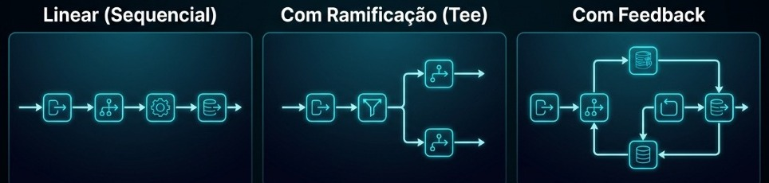

## Roteiro

1. O problema antes da solução
2. Definição, origem e os quatro elementos fundamentais
3. Restrições e variantes de topologia
4. Exemplo aplicado: lote vs streaming sob demanda
5. A violação e o impacto mensurável ($C_e$)
6. Trade-offs e critérios de decisão arquitetural

## O problema antes da solução

Sistemas de processamento contínuo tendem ao **monólito rígido**:

- **Lógica concentrada**: transformações encadeadas dentro de um único bloco de código
- **Efeito dominó**: alterar uma regra de validação arrisca quebrar etapas posteriores
- **Violação de modularidade**: decomposição estruturada por ordem temporal de execução, em vez de por informação escondida [@parnas1972modularization]

::: {.notes}
Abrir pelo problema: no dia a dia, quando um pipeline precisa de uma nova etapa ou correção, um sistema monolítico força a retestar e arriscar todo o fluxo de ponta a ponta.
:::

## Definição do estilo

> **Pipe and Filter** organiza o processamento como uma sequência de transformações independentes (**filtros**), conectadas por canais de transmissão (**pipes**) [@shaw1996software, cap. 2].

- **Filtro**: componente isolado que recebe dados, transforma e produz saída
- **Pipe**: canal condutor que transporta o fluxo sem alterar o conteúdo
- **Autonomia de projeto**: cada filtro opera como caixa-preta sem conhecer os vizinhos

## Origem e inspiração Unix

- **Filosofia Unix**: utilitários pequenos combinados via pipe de texto [@richards2020fundamentals, cap. 11]
  ```bash
  cat logs.txt | grep "ERROR" | sort | uniq -c
  ```
- **Formalização arquitetural**: Meunier define o pipe como garantidor de interface e protocolo uniforme entre etapas [@meunier1995pipes]
- **Aplicações industriais**: compiladores (léxico $\rightarrow$ sintático $\rightarrow$ semântico), pipelines de ETL e streaming (Kafka, Flink)

## Os quatro elementos fundamentais

Baseado nas convenções de componentes e conectores [@clements2010documenting, cap. 4]:

- **Pump (Fonte de dados)**: ponto de entrada que injeta os dados brutos no fluxo
- **Filtro**: unidade de processamento funcional sem estado compartilhado
- **Pipe**: canal que acopla a saída de um filtro à entrada do próximo
- **Sink (Consumidor)**: destino final que armazena, exibe ou despacha o resultado

::: {.notes}
O Pump nunca transforma, apenas emite. O Sink nunca transforma, apenas consome ou persiste.
:::

## Estrutura conceitual

{fig-align="center" width="95%"}

- Cada filtro atua como uma **caixa-preta** independente
- Toda a comunicação é explícita e ocorre exclusivamente através dos pipes

## O que o estilo proíbe

Restrições que preservam a integridade arquitetural [@bass2021software, cap. 1]:

- **Sem invocações diretas**: filtros nunca chamam métodos de outros filtros
- **Sem memória compartilhada**: toda troca de informação ocorre pelos pipes
- **Sem ciclos de dependência**: o fluxo de dados é estritamente unidirecional
- **Sem quebra de contrato**: pipes impõem interface e formato compatível

## Variantes de topologia {.smaller}

{fig-align="center" width="95%"}

- **Linear (Sequencial)**: cadeia única estrita, a mais comum e previsível
- **Com Ramificação (*Tee*)**: divide o fluxo para processamento paralelo
- **Com Feedback**: retorno a estágio prévio (raro; restrito a sistemas de controle)

## Exemplo aplicado: pipeline textual

Caso concreto implementado no notebook deste projeto:

1. **Normalizar**: converte para minúsculas e remove pontuação
2. **Tokenizar**: divide o texto contínuo em lista de palavras
3. **Filtrar**: elimina stop words (termos sem valor semântico)
4. **Contar**: calcula a frequência de ocorrência dos termos

::: {.notes}
Cada transformação cumpre estritamente o Princípio da Responsabilidade Única (SRP).
:::

## Pipeline textual em ação

```{mermaid}
flowchart LR
    IN[/"Texto Bruto<br/><i>string</i>"/] -->|pipe: str| F1["1. Normalizar<br/><i>limpeza</i>"]
    F1 -->|pipe: str| F2["2. Tokenizar<br/><i>segmentação</i>"]
    F2 -->|pipe: list| F3["3. Filtrar Stop Words<br/><i>limpeza semântica</i>"]
    F3 -->|pipe: list| F4["4. Contar Frequências<br/><i>agregação</i>"]
    F4 -->|pipe: dict| OUT[/"Frequências<br/><i>resultado</i>"/]

    style IN fill:#0c4a6e,stroke:#38bdf8,stroke-width:2px,color:#e0f2fe
    style F1 fill:#1e293b,stroke:#818cf8,stroke-width:2px,color:#f8fafc
    style F2 fill:#1e293b,stroke:#818cf8,stroke-width:2px,color:#f8fafc
    style F3 fill:#1e293b,stroke:#818cf8,stroke-width:2px,color:#f8fafc
    style F4 fill:#1e293b,stroke:#818cf8,stroke-width:2px,color:#f8fafc
    style OUT fill:#064e3b,stroke:#34d399,stroke-width:2px,color:#ecfdf5
```

- Filtros substituíveis sem intervenção no restante da cadeia
- Trocar o idioma exige substituir apenas o filtro 3

## Execução: lote versus streaming {.smaller}

No design de pipes, a estratégia de fluxo define o consumo de recursos:

- **Processamento em lote (batch)**:
  - O filtro consome todos os dados antes de repassar a lista completa
  - Simples, mas inviável para grandes massas de dados (risco de estourar a memória RAM)

- **Processamento em fluxo contínuo (streaming com yield)**:
  - Cada filtro consome e emite **um item por vez** sob demanda
  - Mantém o uso de memória mínimo e constante, viabilizando processar arquivos gigantescos

::: {.notes}
O notebook do projeto demonstra ambas as abordagens em Python puro, comprovando a estabilidade de memória via yield.
:::

## A violação na prática

O que acontece quando violamos a independência entre filtros?

```python
# Violação: ContadorAcoplado acessa diretamente a instância do Normalizador
class ContadorAcoplado:
    def __init__(self, normalizador: NormalizadorAcoplado):
        self.normalizador = normalizador  # Dependência direta entre filtros

    def __call__(self, palavras: list[str]) -> dict[str, int]:
        idioma = self.normalizador.idioma  # Acesso a estado interno fora do pipe
        ...
```

- **Acoplamento direto**: dependência externa oculta fora do canal do pipe
- **Perda de intercambiabilidade**: impossível substituir o normalizador isoladamente
- **Testes comprometidos**: exige instanciar o componente normalizador para testar a contagem

## Diagrama da violação arquitetural

```{mermaid}
flowchart LR
    N["Normalizador<br/><i>estado: idioma='pt'</i>"] -->|pipe: texto| T["Tokenizador"]
    T -->|pipe: tokens| C["Contador"]
    C -.->|"VIOLAÇÃO: acoplamento direto"| N

    style N fill:#1e293b,stroke:#818cf8,stroke-width:2px,color:#f8fafc
    style T fill:#1e293b,stroke:#818cf8,stroke-width:2px,color:#f8fafc
    style C fill:#1e293b,stroke:#818cf8,stroke-width:2px,color:#f8fafc
    linkStyle 2 stroke:#fb7185,stroke-width:3px,stroke-dasharray: 5 5
```

- A quebra de encapsulamento destrói a modularidade de Parnas
- O pipeline deixa de ser um fluxo unidirecional limpo

## Consequência mensurável: $C_e$

Métricas formais apuradas no experimento do notebook:

- **Acoplamento Eferente ($C_e$)**:
  - Versão correta: $C_e = 0$ dependências entre filtros
  - Versão violada: $C_e$ dobra ($C_e = 1$), criando dependência rígida
- **Custo de modificação**: trocar um componente exige alterar dois módulos
- **Comportamento correto**: zero efeito colateral ao reordenar ou trocar filtros

> *"Sem número, é opinião. A arquitetura se valida pela métrica."*

## Balanço de trade-offs

- **Vantagens arquiteturais**:
  - **Reusabilidade e composição**: filtros reutilizáveis em pipelines distintos [@meunier1995pipes]
  - **Manutenibilidade**: cada transformação é testável e substituível isoladamente
  - **Paralelismo natural**: filtros podem rodar concorrentemente em nós separados

- **Custos e compromissos**:
  - **Overhead de serialização**: passar dados entre pipes consome CPU e latência [@bass2021software, cap. 13]
  - **Tratamento de exceções**: falhas exigem canais dedicados (*dead-letter channels*) [@hohpe2003enterprise]

## Matriz de trade-offs {.smaller}



::: {.notes}
A tabela sintetiza os compromissos: ganhamos em manutenibilidade e reuso, mas pagamos em custo de serialização e complexidade de erros.
:::

## Critérios de decisão: quando usar

- **Transformações decomponíveis em etapas**: compiladores, pipelines de ETL e logs
- **Reutilização de regras funcionais**: etapas aplicáveis a múltiplos fluxos da organização
- **Necessidade de reconfiguração dinâmica**: adicionar ou remover validações sem reescrever o sistema
- **Divisão de trabalho independente**: diferentes times mantendo filtros diferentes com contrato estável

## Critérios de decisão: quando evitar

- **Latência estrita em tempo real**: quando a serialização em cada etapa inviabiliza os requisitos de tempo
- **Sistemas interativos e bidirecionais**: fluxo unidirecional não suporta diálogo síncrono contínuo
- **Dependência de estado compartilhado global**: regras de negócio que necessitam de transações ACID
- **Antipadrão identificável**: presença de um filtro "orquestrador" que centraliza o controle

## Referências {.smaller}

::: {#refs}
:::
